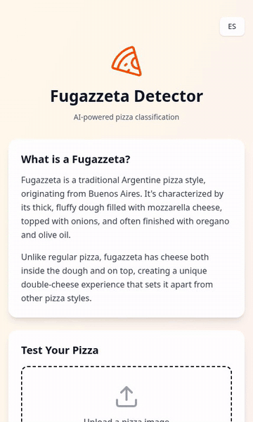

# Fugazzeta Detector

[](https://github.com/jonorl/fugazzeta-frontend/actions/workflows/test.yml)
[](https://github.com/jonorl/fugazzeta-frontend/actions/workflows/deploy.yml)
[](https://github.com/jonorl/fugazzeta-frontend/security/code-scanning)
[](https://pizza.jonathan-orlowski.dev/health)
[](LICENSE)

Upload a photo of a pizza and find out whether it is a fugazzeta. Try it at [jonathan-orlowski.dev/fugazzeta/](https://jonathan-orlowski.dev/fugazzeta/).

Fugazzeta is a pizza from Buenos Aires: a thick, fluffy dough filled with mozzarella and topped with onions, so the cheese sits inside the dough as well as on top. The classifier is a fine-tuned `convnext_tiny` built with fastai. It was my first machine-learning project, made while following Jeremy Howard's [Practical Deep Learning for Coders](https://course.fast.ai/).

<p align="center">
  <a href="https://jonathan-orlowski.dev/fugazzeta/">
    
  </a>
</p>

## Architecture

- **Frontend** (repository root): a React single-page app, built by Cloudflare Pages on every push. It sends the image to the model with `@gradio/client` and shows the label and confidence, in English or Spanish.
- **Model API** (`/server`): a Gradio app mounted on FastAPI, which adds `/health`. It runs in Docker on a VPS behind Caddy at `pizza.jonathan-orlowski.dev`. The trained `model.pkl` is not in the repository; the VPS mounts it into the container at `/app/models`.

## Project structure

```
├── src/
│   ├── App.tsx                 # The whole UI: upload, analysis and result
│   └── consts/translations.ts  # English and Spanish strings
├── public/
│   ├── _headers                # Cloudflare Pages security headers (CSP)
│   └── gtag-init.js            # Google Analytics bootstrap
└── server/
    ├── app.py                  # Gradio + FastAPI app served in production
    ├── tests/                  # pytest suite, run against a stub model
    ├── fetchSamples.py         # Downloads training images
    ├── trainingModel.py        # Trains the classifier and exports model.pkl
    ├── modelOutput.py          # Tries the exported model on one image
    └── Dockerfile
```

## Model

- **Task:** binary image classification. The two labels are `fugazzeta` and `pizza argentina`, taken from the folder names the images are downloaded into.
- **Data:** up to 200 DuckDuckGo image results for each of "fugazzeta photo" and "pizza argentina photo", resized to at most 400 px. Corrupt files are removed, and a fixed random 20% (seed 42) is held out for validation.
- **Architecture:** `convnext_tiny` pre-trained on ImageNet, fine-tuned with fastai.
- **Training:** the learning rate comes from `lr_find`. The new head trains for 3 epochs with the body frozen, then up to 10 more; then the whole network trains for up to 20 epochs with discriminative learning rates. Early stopping watches the validation loss, and the best epoch's weights are the ones exported.
- **Augmentation:** a squish resize to 460 px, then random crops to 224 px, flips, rotation up to 15°, warping and lighting changes.
- **Serving:** `app.py` repeats the validation preprocessing by hand (squish to 460, centre-crop to 224, ImageNet normalisation) and calls the network directly, which is faster on the VPS's CPU than fastai's prediction pipeline.

### Limitations

- Every image gets one of the two labels, so a photo of something that is not a pizza still comes back as one of them.
- The labels are whatever the search engine returned for each query and were not checked by hand, so some training images are likely mislabelled.
- The validation images come from the same searches as the training images, so validation accuracy probably overstates how well it does on people's own photos.

## Tech stack

- **Frontend:** React 19, TypeScript, Vite, Tailwind CSS, Lucide and React Icons
- **Model:** fastai and PyTorch (CPU), served with Gradio and FastAPI
- **Hosting:** Cloudflare Pages for the frontend; Docker, Caddy and GHCR on the VPS for the model

## Getting started

### Frontend

```bash
npm install
npm run dev
```

Then open `http://localhost:5173`. The app calls the production model API, so nothing else needs to run.

### Model API

You need a trained `model.pkl` in `server/models/`. To make one, run `python fetchSamples.py` and then `python trainingModel.py` from `server/`; training also writes its validation results and confusion matrix to `docs/`. `python modelOutput.py <image>` tries the result on one photo.

```bash
cd server
docker build -t fugazzeta .
docker run -p 7861:7861 -v "$PWD/models:/app/models" fugazzeta
```

`http://localhost:7861` serves the Gradio page, and `http://localhost:7861/health` the health check.

## Testing

### Frontend

```bash
npm test                # once
npm run test:watch      # re-run on changes
npm run test:coverage   # with a coverage report
npm run typecheck       # TypeScript, without building
npm run lint            # ESLint
```

The Jest suite covers the language toggle, uploading an image, both results, the error message and starting again, with the Gradio client mocked. It also checks that both languages have the same strings.

### Model API

```bash
cd server
pip install -r requirements.txt -r requirements-dev.txt
python -m pytest                       # tests
ruff check . && ruff format --check .  # lint and formatting
```

The tests swap in a stub model, so they need no `model.pkl`. They check that `/health` answers `GET` and `HEAD`, that Gradio still exposes the `classify_image` endpoint the frontend calls, and that images of any size and colour mode reach the network as normalised 224 × 224 tensors.

## Deployment

- **Model API:** pushing to `main` with changes under `server/` runs the `Build and Deploy` workflow. It runs the tests first, then builds the Docker image, pushes it to `ghcr.io/jonorl/fugazzeta`, then pulls it on the VPS and recreates the container with Docker Compose. A final smoke test waits until `/health` reports the new commit, then checks that Gradio still exposes the endpoint the frontend calls, and fails the run otherwise.
- **Frontend:** Cloudflare Pages builds it on every push, with preview deployments for other branches.

## Security and maintenance

- **CI:** the `Test` workflow runs on every push and pull request. It type-checks, lints and tests the frontend, and lints and tests the model API.
- **Branch ruleset:** changes to `main` go through a pull request with passing tests and no new high or critical CodeQL alerts. Force-pushes and deletion are blocked; repository admins can bypass.
- **CodeQL:** scans the TypeScript, the Python and the workflows weekly and on every pull request.
- **Content Security Policy:** enforced from [`public/_headers`](public/_headers), alongside other security headers. Scripts load only from the site itself, Google Analytics and Cloudflare Web Analytics, and the page can only talk to the model API and the two analytics services.
- **Dependabot:** security updates as soon as an advisory appears, and version updates every Monday for npm, pip and the Docker base image, and monthly for GitHub Actions. Minor and patch bumps arrive grouped. The model's own stack (fastai, fastcore, timm), Pillow and torch are held back; [`.github/dependabot.yml`](.github/dependabot.yml) explains why.
- **Secret scanning** with push protection is on.

## Author

Developed by [Jonathan Orlowski](https://jonathan-orlowski.dev/). Licensed under the Apache License 2.0, see [`LICENSE`](LICENSE).
